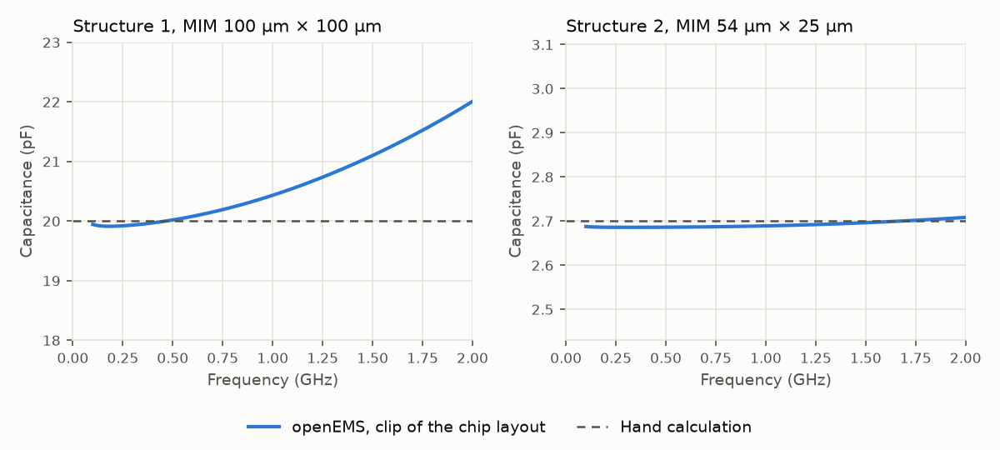
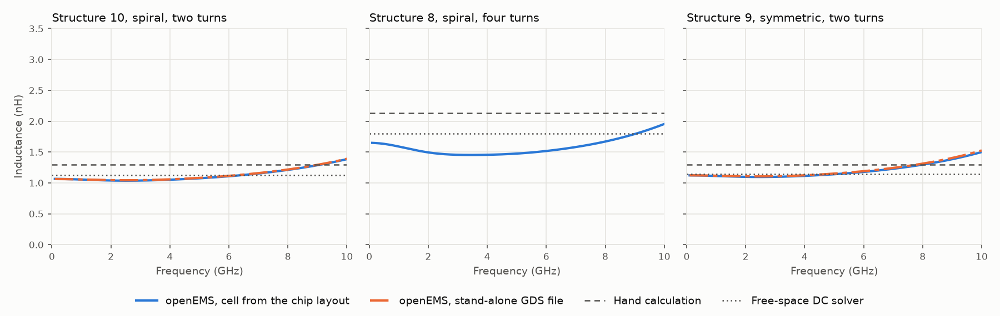

# Simulations

This directory checks the expected values in the
[top-level&nbsp;README](../../README.md), which are hand calculations from
[`docs/scripts/expected_values.py`](../scripts/expected_values.py), against
simulations of the drawn layout. It covers the two MIM capacitors and the three
inductors. The transformers have no hand calculation and are not simulated here.

## Summary

| # | Structure | Quantity | Hand calculation | Simulation | Difference | Method |
|---|---|---|---|---|---|---|
| 1 | MIM capacitor, 100&nbsp;µm&nbsp;×&nbsp;100&nbsp;µm | C | 20.0 pF | 19.93 pF | −0.3 % | openEMS |
| 1 | | | | 20.00 pF | 0.0 % | PDK ngspice model |
| 2 | MIM capacitor, 54&nbsp;µm&nbsp;×&nbsp;25&nbsp;µm | C | 2.70 pF | 2.686 pF | −0.5 % | openEMS |
| 2 | | | | 2.724 pF | +0.9 % | PDK ngspice model |
| 10 | Spiral inductor, two turns | L | 1.30 nH | 1.065 nH | −18 % | openEMS |
| 10 | | | | 1.122 nH | −14 % | free-space DC solver |
| 10 | | R | 0.84 Ω | 0.878 Ω | +4 % | DC solver |
| 8 | Spiral inductor, four turns | L | 2.13 nH | 1.646 nH | −23 % | openEMS |
| 8 | | | | 1.796 nH | −16 % | free-space DC solver |
| 8 | | R | 1.18 Ω | 1.290 Ω | +9 % | DC solver |
| 9 | Symmetric inductor | L | 1.30 nH | 1.122 nH | −14 % | openEMS |
| 9 | | | | 1.143 nH | −12 % | free-space DC solver |
| 9 | | R | 0.87 Ω | 0.893 Ω | +2 % | DC solver |

The differences are taken against the unrounded hand calculation. The
capacitances agree with the hand calculation to within 1 %. The DC resistances
agree to within 9 %. The simulated inductances are 12 % to 23 % below the hand
calculation: both simulation methods, which use the drawn geometry, give lower
values than the closed-form expression. The openEMS
inductances are those of the cells taken from the chip layout. For structures
10 and 9 they agree to within 0.2 % with the author's stand-alone files in
[`seperate_GDSs/`](../../seperate_GDSs/README.md); see [Inductors](#inductors).

## Methods

| Method | What it computes | Files |
|---|---|---|
| [openEMS](https://www.openems.de/) through [gds2openEMS](https://github.com/VolkerMuehlhaus/gds2openEMS) | S-parameters from 0 to 20 GHz by the finite-difference time-domain method, in the layer stack of the substrate, oxide and metals | [`make_models.py`](make_models.py), [`run_openems.py`](run_openems.py) |
| PDK ngspice model | Capacitance of `cap_mim_2f0_m4m5_noshield`, the 2 fF/µm² MIM capacitor between Metal4 and Metal5, at the typical, slow and fast corners | [`tb_mim.spice.in`](tb_mim.spice.in), [`run_mim.py`](run_mim.py) |
| DC resistor network | Resistance between the terminals, from every metal layer rasterised on a 0.5 µm grid and joined by the via arrays | [`dc_resistance.py`](dc_resistance.py) |
| Free-space magnetostatics | Inductance of the DC current distribution of the network, with no substrate and no enclosure | [`dc_inductance.py`](dc_inductance.py) |

The DC solvers use the same metal and via conductivities as the openEMS stack
file, so they test the openEMS solution with an independent numerical method.
The free-space inductance is the quantity that the hand calculation estimates.

## Conditions

| Item | Value |
|---|---|
| Layer stack | [`OPENEMS-GF180MCUD-1P5M-TM11KA-MIMB.xml`](https://github.com/EngGhaith/The-Silent-Owl-GF180MCU-WB-LNA/blob/7deb253d3b96f0daf68dac80536ab2ca4f24b464/EM-Flow/OPENEMS-GF180MCUD-1P5M-TM11KA-MIMB.xml) by the author of the chip, downloaded at run time |
| Metals | Metal1 to Metal4 0.55 µm at 20.2 MS/m (0.090 Ω/sq), Metal5 1.19 µm at 21.0 MS/m (0.040 Ω/sq) |
| MIM dielectric | 0.31 µm with a relative permittivity of 70, which gives 2.0 fF/µm² |
| Substrate | 191 µm of silicon at 2 S/m under 8.5 µm of oxide |
| Enclosure | Perfect conductors on all six faces, 200 µm from the layout at the sides, under the substrate and 300 µm above the chip |
| Mesh | 1 µm in the metal, one cell per metal and via layer in height |
| Stop criterion | Field energy 50 dB below its peak |
| Software | openEMS v0.37.0-rc3, gds2openEMS at commit [`551deea`](https://github.com/VolkerMuehlhaus/gds2openEMS/tree/551deea7b3a89d904086d7a4d06d5133b2b4f186), ngspice 44.2, gf180mcuD models from [wafer-space/gf180mcu](https://github.com/wafer-space/gf180mcu) at commit [`ac7d869`](https://github.com/wafer-space/gf180mcu/tree/ac7d8696de96a4d708e768b607ae37f02207a354), KLayout 0.30.12, NumPy 2.5.4 and SciPy 1.18.1 for the DC solvers |

The openEMS values are read at 0.2 GHz for the inductors and at 0.3 GHz for
the capacitors. Below about 0.1 GHz the simulated time is too short to resolve
the response, and above about 1 GHz the feed lines and the self-resonance
change the apparent values.

## Files

| File | Contents |
|---|---|
| [`Dockerfile`](Dockerfile) | Image with openEMS, gds2openEMS and ngspice. |
| [`make_models.py`](make_models.py) | Writes the openEMS model layouts to `build/` from the chip layout, with the ground ring cut and closed. |
| [`run_openems.py`](run_openems.py) | Runs one openEMS model and writes its S-parameters and derived values. |
| [`tb_mim.spice.in`](tb_mim.spice.in), [`run_mim.py`](run_mim.py) | ngspice testbench of the PDK MIM model and its driver. |
| [`dc_resistance.py`](dc_resistance.py), [`dc_inductance.py`](dc_inductance.py) | DC resistance and free-space inductance. |
| [`plot_results.py`](plot_results.py) | Draws the figures and writes [`results/summary.csv`](results/summary.csv). |
| [`results/`](results) | Touchstone files (`.s1p`, `.s2p`), the derived values against frequency (`.csv`) and the summary tables. |

## Running the simulations

From the repository root:

1. Build the image, and clone the PDK at the commit that was used and link its
   `gf180mcuD` directory into this directory. The PDK clone can live anywhere;
   `../gf180mcu` is an example.

   ```sh
   docker build -t rlcm-sim docs/sim
   git clone https://github.com/wafer-space/gf180mcu ../gf180mcu
   git -C ../gf180mcu checkout ac7d869
   ln -s "$(readlink -f ../gf180mcu/gf180mcuD)" docs/sim/pdk
   ```

2. Unzip the chip layout and write the model layouts. Each inductor cell is
   written twice, with the ground ring cut and, as `<name>_closed`, closed:

   ```sh
   unzip -o RLCMV4_filled.zip -d build
   uv run docs/sim/make_models.py
   ```

3. Run each openEMS model. Each takes 30 to 100 minutes with 12 to 24 threads.
   The names are listed in `MODELS` in [`run_openems.py`](run_openems.py).

   ```sh
   docker run --rm -u "$(id -u):$(id -g)" -e HOME=/tmp -e OPENEMS_THREADS=16 \
       -v "$PWD":/repo -w /repo rlcm-sim python3 docs/sim/run_openems.py mim_54x25
   ```

4. Run the PDK model and the DC solvers, then draw the figures:

   ```sh
   docker run --rm -u "$(id -u):$(id -g)" -v "$PWD":/repo \
       -v "$(readlink -f docs/sim/pdk)":"$(readlink -f docs/sim/pdk)":ro \
       -w /repo/docs/sim rlcm-sim python3 run_mim.py
   uv run docs/sim/dc_resistance.py
   uv run docs/sim/dc_inductance.py
   uv run docs/sim/plot_results.py
   ```

gds2openEMS stores a hash of each model with its field data in `build/`, and
skips the solver when the model is unchanged. The hash also covers
[`run_openems.py`](run_openems.py) up to its `runSimulation()` call, so step 3
redoes only the post-processing as long as neither the model nor that part of
the script has changed.

## Capacitors

### Model

Each model is a clip of the chip layout that contains the capacitor and the
parallel parts of its two feed stubs, from 2.7 µm above the launch. The Via4
cuts on the top plate are moved to layer 1041, as the
[README of the stack file](https://github.com/EngGhaith/The-Silent-Owl-GF180MCU-WB-LNA/blob/7deb253d3b96f0daf68dac80536ab2ca4f24b464/EM-Flow/README.md)
requires: on layer 41 they would join Metal4 to Metal5 through the dielectric.
One lumped port spans the 2 µm gap between the S1 and S2 stubs at their lower
end. Its impedance is 5 Ω, which shortens the simulation tenfold and does not
change the impedance that is derived from it.

### Results

| # | Hand calculation | PDK model, typical | PDK model, slow and fast corners | openEMS |
|---|---|---|---|---|
| 1 | 20.0 pF | 20.00 pF | 22.00 pF, 18.00 pF | 19.93 pF |
| 2 | 2.70 pF | 2.724 pF | 3.00 pF, 2.45 pF | 2.686 pF |

The PDK model adds a perimeter term of 0.24 fF/µm to the area term of
1.99 fF/µm², which accounts for its 0.9 % excess on the small capacitor. The
stack file models the dielectric as exactly 2.0 fF/µm², so openEMS checks the
geometry and the feed, not the value of the dielectric.

Only the capacitance is taken from the capacitor runs. Their real part, which
the result files also contain, falls steeply with frequency: for the larger
capacitor from 4.7 Ω at 0.1 GHz to 0.73 Ω at 0.3 GHz and 0.31 Ω at 1 GHz.
This repository does not establish whether the low-frequency values are
physical or a consequence of the limited simulated time, and they are not used.



*Figure 1. Capacitance from openEMS, −1 / (2πf Im Z), against the hand
calculation. The rise with frequency is the series inductance of the feed
stubs, which matters first for the larger capacitor.*

## Inductors

### Models

| Model | Source | Ground ring |
|---|---|---|
| Stand-alone two-turn spiral | [`Ind2_D250_N2_W26_TO.gds`](../../seperate_GDSs/Ind2_D250_N2_W26_TO.gds) as drawn by the author | 6 µm wide, closed by a Metal5 bar 1 µm in front of the terminals, cut on the opposite side |
| Stand-alone symmetric inductor | [`Ind3_D250_N2_W26_TO.gds`](../../seperate_GDSs/Ind3_D250_N2_W26_TO.gds) as drawn by the author | the same |
| Chip cells of structures 10, 8 and 9 | the cell from the chip layout, written by [`make_models.py`](make_models.py) | the 14 µm ring of the chip, with the same bar and cut added |

The port markers on layers 201 and 202 span the 1 µm gap between each terminal
and the bar, so each port is referenced to the ground ring. The centre tap of
the symmetric inductor is left open. The inductance and resistance are those
between the two terminals, from Z11 + Z22 − Z12 − Z21.

### Results

| Model | L, hand | L, free space | L, openEMS | R, hand | R, DC solver | R, DC solver with return | R, openEMS | Peak Q, openEMS |
|---|---|---|---|---|---|---|---|---|
| Chip cell, two-turn spiral [10] | 1.30 nH | 1.122 nH | 1.065 nH | 0.84 Ω | 0.878 Ω | 0.914 Ω | 0.933 Ω | 11.7 at 6.1 GHz |
| Stand-alone two-turn spiral | 1.30 nH | 1.122 nH | 1.063 nH | 0.84 Ω | 0.878 Ω | 0.947 Ω | 0.967 Ω | 11.8 at 5.9 GHz |
| Chip cell, four-turn spiral [8] | 2.13 nH | 1.796 nH | 1.646 nH | 1.18 Ω | 1.290 Ω | 1.327 Ω | 1.473 Ω | 4.7 at 3.5 GHz |
| Chip cell, symmetric inductor [9] | 1.30 nH | 1.143 nH | 1.122 nH | 0.87 Ω | 0.893 Ω | 1.046 Ω | 1.073 Ω | 11.6 at 6.3 GHz |
| Stand-alone symmetric inductor | 1.30 nH | 1.143 nH | 1.123 nH | 0.87 Ω | 0.893 Ω | 1.523 Ω | 1.547 Ω | 10.5 at 7.0 GHz |

The numbers in brackets are the structure numbers. The openEMS values are read
at 0.2 GHz. The chip cells and the stand-alone files have the same winding and
differ in the ground ring, and their inductances agree to within 0.2 %.



*Figure 2. Inductance from openEMS, Im(Z) / (2πf), between the two terminals,
against the hand calculation and the free-space DC solver.*

### Resistance

The openEMS resistance includes the ground return between the two port
references along the Metal5 bar. The DC solver gives that return separately,
and the column "with return" adds it to the winding. For the two-turn spiral
and the symmetric inductor, openEMS is within 1 % to 3 % of that sum, in both
the chip cells and the stand-alone files, although the return in the
stand-alone symmetric inductor is four times that in the chip cell. For the
four-turn spiral openEMS is 11 % higher at 0.2 GHz and 8 % higher at
0.05 GHz, and its resistance rises with frequency faster than that of the other
inductors, to 2.4 Ω at 1 GHz. This repository does not establish the cause.

The winding resistance alone is the "DC solver" column, which is 2 % to 9 %
above the hand calculation. The hand calculation divides the Metal5 area of
the winding by the square of the track width and takes five metals in
parallel throughout. The DC solver also includes the resistance of the vias,
the parts of the underpass and crossover that run on fewer metals, and the
current distribution at the corners. This repository does not establish how
much each of these contributes.

### Inductance

The free-space solver reproduces the closed-form partial inductance of a
straight bar of the same cross-section to 0.6 %, and its result changes by
0.1 % between a 1 µm and a 0.5 µm grid. It is 12 % to 16 % below the hand
calculation for the three inductors. The hand calculation uses the expression
of [Mohan et al.](https://doi.org/10.1109/4.792620) for an ideal square
spiral; the solver uses the drawn metal, including the underpass, the step
where each turn moves inwards and the terminal stubs. This repository does not
establish which of these accounts for the difference.

openEMS gives a further 2 % to 8 % less than free space: 5 % for the two-turn
spiral, 8 % for the four-turn spiral and 2 % for the symmetric inductor.
Moving the side walls
of the enclosure from 200 µm to 600 µm changes the result by 0.6 %
([`Ind2_D250_N2_W26_TO_far.csv`](results/Ind2_D250_N2_W26_TO_far.csv)), so the
side walls are not the cause. The parts of the model that the free-space
solver leaves out are the conductive substrate and the conducting planes above
and below.

### Closed ground ring

On the chip, the Metal5 ring of each inductor cell is open only where the
terminals pass through it. [`make_models.py`](make_models.py) also writes each
chip cell with the bar but without the cut on the opposite side, which forms a
closed loop around the winding. That loop lowers the openEMS inductance at
0.2 GHz as follows:

| Structure | Ring cut | Ring closed | Change |
|---|---|---|---|
| Two-turn spiral [10] | 1.065 nH | [0.927 nH](results/spiral_2turn_closed.csv) | −13 % |
| Four-turn spiral [8] | 1.646 nH | [1.499 nH](results/spiral_4turn_closed.csv) | −9 % |
| Symmetric inductor [9] | 1.122 nH | [0.936 nH](results/symmetric_closed.csv) | −17 % |

On the chip the ring is joined to the launch ground on both sides of the
terminals, so a measurement may see part of this effect. The simulated models
do not contain the launches.

## The openEMS workflow

The stated purpose of the chip is to verify an openEMS simulation flow
against silicon. The repository does not name the flow. The simulations in
this directory use the components below, which are published elsewhere:

| Component | Location |
|---|---|
| GDS to openEMS workflow | [VolkerMuehlhaus/gds2openEMS](https://github.com/VolkerMuehlhaus/gds2openEMS) |
| GDS to Palace workflow, not used here | [VolkerMuehlhaus/gds2palace_ihp_sg13g2](https://github.com/VolkerMuehlhaus/gds2palace_ihp_sg13g2) |
| GF180MCUD stack files for both, by the author of this chip | [`EM-Flow/` in EngGhaith/The-Silent-Owl-GF180MCU-WB-LNA](https://github.com/EngGhaith/The-Silent-Owl-GF180MCU-WB-LNA/tree/main/EM-Flow) |
| Stack viewer | [VolkerMuehlhaus/setupEM](https://github.com/VolkerMuehlhaus/setupEM) |

The workflow takes a GDS file, an XML description of the metal and dielectric
stack, and a Python model script. Ports are drawn in the GDS as polygons on
additional layers, by convention 201 and above, and the model script maps each
layer to a port number. The inductor and transformer cells on this chip carry
such polygons on layers 201 to 207. They are listed per cell under
[EM port markers in `docs/README.md`](../README.md#em-port-markers).

The stand-alone files
[`Ind2_D250_N2_W26_TO.gds`](../../seperate_GDSs/Ind2_D250_N2_W26_TO.gds) and
[`Ind3_D250_N2_W26_TO.gds`](../../seperate_GDSs/Ind3_D250_N2_W26_TO.gds)
differ from their `CLEAN` versions,
[`Ind2_D250_N2_W26_TO_CLEAN.gds`](../../seperate_GDSs/Ind2_D250_N2_W26_TO_CLEAN.gds)
and
[`Ind3_D250_N2_W26_TO_CLEAN.gds`](../../seperate_GDSs/Ind3_D250_N2_W26_TO_CLEAN.gds),
by one Metal5 bar 1 µm in front of the terminals. With that bar, each port marker spans the gap between a terminal
and ground, which is the arrangement an in-plane port of gds2openEMS needs.
The `TO` files therefore appear to be the author's simulation models; the
repository does not say so.

## Limitations

- The layer stack is that of the chip's author. Its thicknesses and
  conductivities have not been compared with the foundry data here.
- The substrate thickness of 191 µm and the conducting plane beneath it are
  properties of the stack file, not of the packaged chip.
- The models leave out the launches and pads. Measured values include them
  until they are de-embedded with the structures described in the
  [top-level&nbsp;README](../../README.md#de-embedding-structures).
- The lumped ports add a small series inductance that is not removed.
- The openEMS resistances and quality factors of the inductors include the
  ground return between the two ports (see [Resistance](#resistance)), so the
  quality factors are lower than those of the winding alone.

## References

Listed with the chip's author first, then the author of the workflow, then
general references.

- G. Al Sabagh, "The Design Journey of mWATTBAT: The Open-Source Radar Chip,"
  master's thesis, Johannes Kepler University Linz, 2026, which has a section
  on transmission lines in openEMS.
  [PDF](https://epub.jku.at/download/pdf/13546624.pdf)
- V. Mühlhaus, [gds2openEMS](https://github.com/VolkerMuehlhaus/gds2openEMS),
  the GDS to openEMS workflow used here.
- V. Mühlhaus, "User friendly workflow for RFIC EM simulation using openEMS,"
  talk at the Free Silicon Conference, 2025.
  [Programme](https://wiki.f-si.org/FSiC2025)
- T. Liebig, A. Rennings, S. Held, D. Erni, "openEMS: a free and open source
  equivalent-circuit (EC) FDTD simulation platform supporting cylindrical
  coordinates suitable for the analysis of traveling wave MRI applications,"
  International Journal of Numerical Modelling, vol. 26, no. 6, pp. 680-696,
  2013. [doi:10.1002/jnm.1875](https://doi.org/10.1002/jnm.1875)
- S. S. Mohan, M. del Mar Hershenson, S. P. Boyd, T. H. Lee, "Simple accurate
  expressions for planar spiral inductances," IEEE Journal of Solid-State
  Circuits, vol. 34, no. 10, pp. 1419-1424, 1999.
  [doi:10.1109/4.792620](https://doi.org/10.1109/4.792620)
- E. B. Rosa, "The self and mutual-inductances of linear conductors," Bulletin
  of the Bureau of Standards, vol. 4, no. 2, pp. 301-344, 1908.
  [doi:10.6028/bulletin.088](https://doi.org/10.6028/bulletin.088)
